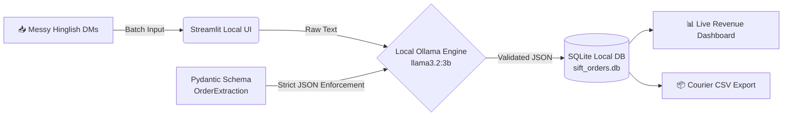

# ⚡ Sift — Offline Hinglish DM-to-Dispatch Engine

> 🏆 **Built for the Week 2 DEV Challenge (Side Hustle: Open-Source AI)**

**Sift** is a 100% local, privacy-first AI desktop utility built for Indian Instagram thrift stores, home bakers, and small D2C sellers. It sifts through messy Hinglish WhatsApp/Instagram DMs and extracts structured, courier-ready dispatch sheets at **₹0.00 inference cost**.

---

## 🏗️ System Architecture



## 💡 Why Open-Source & Local AI Wins Here
1. **Zero Per-Token Cost (100% Margin):** Small Instagram businesses operate on thin margins. Running `llama3.2:3b` locally via Ollama means inference costs **₹0.00**, enabling a flat one-time setup or ₹499/mo subscription without eating into profits.
2. **100% Customer PII Privacy:** DMs contain sensitive home addresses and phone numbers. With Sift, customer data never leaves the seller's laptop.
3. **Deterministic Hinglish Parsing:** Combines open-weight `llama3.2:3b` with **Pydantic** schema validation so slang like *"bhej do"*, *"GPay kar diya"*, and *"COD rakhna"* maps cleanly to database columns without hallucinations.

---

## 🚀 Quick Start (Run Locally)

### 1. Prerequisites
Install [Ollama](https://ollama.com) and pull the open-weight 3B model:
```bash
ollama run llama3.2:3b
```

### 2. Clone & Run Sift
```bash
git clone [https://github.com/](https://github.com/)<YOUR-GITHUB-USERNAME>/Sift.git
cd Sift
python -m venv venv
.\venv\Scripts\activate
pip install -r requirements.txt
streamlit run app.py
```